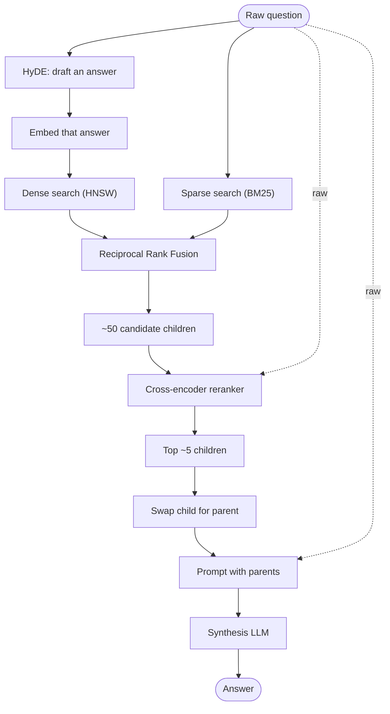
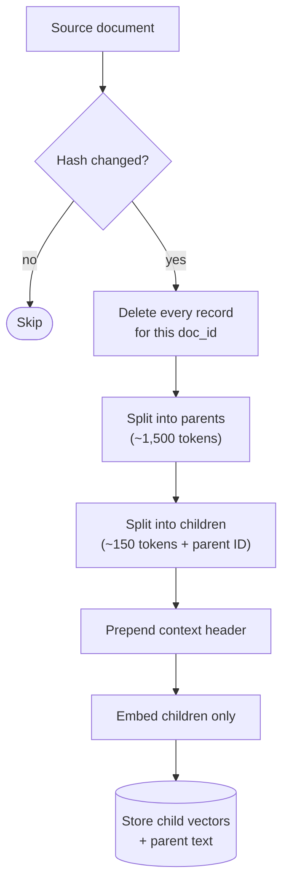

# Where retrieval breaks

<Updated date="2026-11-19" />

<Topics tags={['HyDE', 'Hybrid retrieval', 'BM25', 'Reciprocal Rank Fusion', 'Cross-encoder reranking', 'Lost in the middle', 'Parent–child indexing', 'Contextual enrichment', 'Change Data Capture']} />

The [naive pipeline](the-retrieval-pipeline) — chunk, embed, store, search, stuff into a prompt — demos well. Point it at a real company's documentation and it degrades in four specific, repeatable ways. None of them is exotic; all four are consequences of the design choices the simple version makes.

Each failure below gets the layer that fixes it, and each layer is a deliberate purchase: an extra LLM call, a second index, a model run per candidate, more bookkeeping at ingestion. The point of naming the failures first is that you should be able to point at the one you're paying to fix.

## Failure 1: the right chunk exists, and search can't find it

An engineer asks the internal assistant:

> What should I set `MAX_CONCURRENT_WORKERS_VAL` to?

Nothing comes back but noise — generic pages about "worker management," maybe something about employee configuration. Two separate problems are at work, and it's worth keeping them apart because they need different fixes.

**The query is too short.** A dozen tokens produce a thin, under-specified embedding. The chunk that holds the answer is a dense multi-sentence paragraph with its own vocabulary and rhythm. A question and an answer are simply different *kinds* of text, and asking a bi-encoder to place them in the same neighbourhood is asking a lot.

**The query hinges on an exact string.** Vector search evaluates overall semantic concepts, which makes it structurally blind to precise spellings. `MAX_CONCURRENT_WORKERS_VAL` means roughly "something about parallel workers" to an embedding model, so the search drifts toward documents *about* worker management and sails past the one config reference that literally names the variable. The same blindness applies to serial numbers, error codes, SKUs and version strings.

### Fix 1a: HyDE — search with a fabricated answer

*Changes what goes into [② the embedding model](the-retrieval-pipeline#embedding) on the read path.*

**Hypothetical Document Embeddings (HyDE)** goes after the shape mismatch. Instead of embedding the question, you first ask an LLM to *write the answer it imagines* — something like: "`MAX_CONCURRENT_WORKERS_VAL` sets the number of worker processes the ingestion service runs in parallel. The default is 8; raising it increases throughput but also memory use…"

That answer may be factually wrong, and it does not matter in the slightest, because nobody ever reads it. Its only job is to *look like* a real document — the same vocabulary density, the same explanatory register, the same length. Embedding that instead of the question converts the search from a question-to-answer match into an **answer-to-answer** match, and answers sit far closer to answers in vector space than questions do.

The price is one extra LLM call on the critical path of every query, which is real latency and real money.

### Fix 1b: hybrid retrieval and Reciprocal Rank Fusion

*Adds a second index alongside [③ the vector store](the-retrieval-pipeline#vector-store).*

HyDE sharpens the vector side, but no amount of sharpening makes a vector sensitive to exact spelling. For that you need an index that was never semantic in the first place, so the retrieval path forks into two searches running in parallel:

- **Dense search** — the HNSW vector index, answering "what is this about?"
- **Sparse search** — **BM25** over an **inverted index**: a map from each term to the chunks containing it, scoring a chunk by how often the query's terms appear in it and how rare those terms are across the corpus.<Sidenote>Inverted indexes are covered in [Finding the needle](/system-design/building-blocks/finding-the-needle).</Sidenote> It answers "which chunks literally contain `MAX_CONCURRENT_WORKERS_VAL`?" — so it receives the **raw** question, never the HyDE text.

Now there are two ranked lists, and here is the awkward part: their scores aren't commensurable. One side produces cosine similarities in roughly 0–1; the other produces unbounded term-frequency scores on a scale that shifts with corpus statistics. Adding or averaging them is arithmetic on incompatible units — the answer means nothing.

**Reciprocal Rank Fusion (RRF)** sidesteps the whole problem by throwing the scores away and keeping only each chunk's *position* in each list:

```
                         1
RRF_score(d) =  Σ   ─────────────
               m∈M   k + r_m(d)
```

`d` is a chunk, `M` is the set of retrieval strategies (here: dense and sparse), `r_m(d)` is `d`'s rank inside strategy `m`'s list, and `k` is a smoothing constant conventionally set to **60**. Each strategy contributes one fraction; the chunk's score is the sum.

`k` is doing more work than it appears to. Without it, rank 1 would score 1.0 and rank 2 only 0.5 — so whichever retriever happened to put something first would dominate the fusion, including when it put it there for a spurious reason. With `k = 60`, rank 1 scores 1/61 and rank 2 scores 1/62: adjacent top ranks are worth nearly the same, no single list can swamp the other, and *agreement across lists* becomes the strongest signal in the formula.

Concretely, for the `MAX_CONCURRENT_WORKERS_VAL` query:

| Chunk | Dense rank | Sparse rank | RRF score |
| --- | --- | --- | --- |
| A — general worker-management guide | 1 | 5 | 1/61 + 1/65 ≈ 0.0318 |
| B — config reference naming the variable | 12 | 1 | 1/72 + 1/61 ≈ 0.0303 |
| C — employee-settings page | 2 | 30 | 1/62 + 1/90 ≈ 0.0272 |

Vector search alone buried chunk B at twelfth, well outside anything that would reach the prompt. Fusion lifts it to second. Note what fusion does and doesn't promise: an exact lexical match isn't guaranteed first place, it is guaranteed a *competitive* score — enough to survive into the candidate pool that the next stage judges properly.<Sidenote>The ranks in the table are illustrative — picked to show how the arithmetic plays out.</Sidenote>

## Failure 2: more context makes the answer worse

The model can only answer from what you put in front of it, so when retrieval keeps missing, sending more looks like free insurance: fifty chunks instead of five, a context window big enough to hold them, and let the model pick the good one.

This fails on three counts. Two are economic — fifty chunks cost roughly ten times the tokens of five, and a longer prompt takes longer to process. The third is behavioural, and it is the one that surprises people: transformer attention does not treat a long context uniformly. Models reliably use material at the **beginning** and the **end** of a long prompt and overlook evidence buried in the **middle** — the documented **"lost in the middle"** effect. So padding the prompt with twenty medium-relevance fragments can actively *hide* the one good chunk by pushing it into the dead zone. You pay more, wait longer, and get a worse answer.

### The fix: two-stage retrieval with a cross-encoder

*Adds a new stage between [③ the search](the-retrieval-pipeline#vector-store) and the prompt.*

Accurate relevance scoring does exist — it's just too slow to run over millions of chunks. So split retrieval into a cheap, broad stage and an expensive, narrow one:

1. **Stage 1 — fast and broad.** Hybrid search plus RRF scans millions of vectors and returns about **50** candidates in milliseconds. This stage is tuned for **recall**: its only job is to not lose the answer. Precision is not its problem.
2. **Stage 2 — slow and precise.** A **cross-encoder** — the paired model [the last lesson](the-retrieval-pipeline#bi-encoder) set aside as unaffordable — re-scores those 50 and keeps the best **5**, discarding the rest *before* the prompt is built.

The difference between the two model types is the heart of this:

| | Bi-encoder (retrieval) | Cross-encoder (reranking) |
| --- | --- | --- |
| Reads | question and chunk separately | question and chunk **together**, as one input |
| Output | a vector per text | a single relevance score per pair |
| Precomputable? | yes — chunks embedded offline | no — nothing exists until the question arrives |
| Scales to | millions | tens |

Because a cross-encoder runs full self-attention across the question and the chunk jointly, it can see relationships that two independently computed vectors can never expose — that the chunk answers *this* question rather than merely sharing its topic. And because it can't precompute anything, it must run the model once per (question, chunk) pair, live, which is precisely why it is affordable on 50 candidates and unthinkable on five million.

:::tip Why not just use the cross-encoder for retrieval, if it's more accurate?
Because it has nothing to store ahead of time. It only produces a score when it sees a question and a chunk together, so there is no chunk vector to build an index from, and answering one question would mean running it over the whole corpus. Never seeing the pair is what costs the bi-encoder its accuracy — and the same thing is what lets all its work happen offline.
:::

One detail that's easy to get wrong: the reranker scores candidates against the **raw user question**, not the HyDE answer — otherwise it is grading chunks against the model's own invention.

## Failure 3: the answer is split across two chunks

Back to chunking, where a fixed token size cut a system manual mid-paragraph:

- **Chunk 1:** "The database migration script resolves the severe memory leaks in the data engine ingestion pool. However, if this configuration parameter is modified…"
- **Chunk 2:** "…it will immediately trigger system crashes and corrupted storage blocks across production nodes."

A question about stabilizing memory leaks matches Chunk 1 — the semantic terms are all there. The model receives the fix and never sees the warning that was stranded in Chunk 2. The answer is incomplete in the most dangerous possible direction: confidently recommending a change while omitting what it breaks. This is **context fragmentation**, and its companion is **broken reference scopes** — pronouns, "this parameter," "the above table," all pointing at something that got left in another chunk.

### The fix: hierarchical indexing with contextual enrichment

*Changes [① the splitter](the-retrieval-pipeline#chunking), and what [③ the store](the-retrieval-pipeline#vector-store) hands back.*

The real cause isn't a badly chosen chunk size. It's that **search and generation want opposite sizes**, and the naive pipeline forces one block to serve both.

- Search wants a *narrow* unit, so the query vector matches sharply. A large chunk's embedding is an average of every idea inside it, and averaging dilutes each one until a specific question no longer matches it well.
- Generation wants a *wide* unit, so no instruction is separated from the warning that qualifies it.

**Hierarchical indexing** breaks the assumption that the block you *retrieve* must be the block you *send*:

1. **Split twice.** At ingestion, each document becomes token-heavy **parent chunks** (around 1,500 tokens) that keep complete reference scopes intact. Each parent is then cut into granular **child chunks** (around 150 tokens), each carrying an explicit pointer to its parent's ID.
2. **Enrich before embedding.** A **contextual enrichment** step generates a one-sentence header naming the child's origin and prepends it to the child's text. This is not cosmetic. A child torn from its parent frequently loses the nouns identifying its own subject: a line reading "it defaults to 30 seconds" embeds as a vague remark about seconds and matches no query about timeouts. A header like *"From the API Gateway guide, section on request timeouts:"* injects the missing identifying terms back in before the vector is computed, shifting the child into the region of vector space where real questions live.
3. **Index the children, serve the parents.** Only child vectors are stored and searched. When a query matches a child, the engine **discards that child's text — header included, so the generation model never sees the synthetic sentence — and fetches its unfragmented parent** to put in the prompt.

<figure className="diagram">
<svg viewBox="0 0 700 212" width="700" height="212" role="img" aria-label="Parent–child indexing. On the left, four small child chunks are the only vectors stored in the search index; child 1.2 is highlighted as the search match. Each child points to the parent chunk it came from: children 1.1 and 1.2 point to parent 1, children 2.1 and 2.2 point to parent 2. The parents are stored but never searched. Because the match was child 1.2, the whole of parent 1 is what gets placed into the prompt sent to the LLM.">
  <defs>
    <marker id="rag-pc-arrow" markerWidth="9" markerHeight="9" refX="6" refY="3" orient="auto" markerUnits="userSpaceOnUse"><path d="M0,0 L7,3 L0,6 Z" className="d-accent" /></marker>
  </defs>
  <text className="d-label" x="12" y="16" fontSize="12" textAnchor="start">Embedded and searched</text>
  <rect className="d-fill" x="12" y="26" width="150" height="30" rx="5" />
  <rect className="d-stroke" x="12" y="26" width="150" height="30" rx="5" strokeWidth="1.5" />
  <text className="d-text" x="87" y="45" fontSize="11.5" textAnchor="middle">child 1.1</text>
  <rect className="d-fill" x="12" y="64" width="150" height="30" rx="5" />
  <rect className="d-accent-stroke" x="12" y="64" width="150" height="30" rx="5" strokeWidth="2.5" />
  <text className="d-text" x="87" y="83" fontSize="11.5" textAnchor="middle">child 1.2 — match</text>
  <rect className="d-fill" x="12" y="102" width="150" height="30" rx="5" />
  <rect className="d-stroke" x="12" y="102" width="150" height="30" rx="5" strokeWidth="1.5" />
  <text className="d-text" x="87" y="121" fontSize="11.5" textAnchor="middle">child 2.1</text>
  <rect className="d-fill" x="12" y="140" width="150" height="30" rx="5" />
  <rect className="d-stroke" x="12" y="140" width="150" height="30" rx="5" strokeWidth="1.5" />
  <text className="d-text" x="87" y="159" fontSize="11.5" textAnchor="middle">child 2.2</text>
  <text className="d-label" x="87" y="190" fontSize="11" textAnchor="middle">~150 tokens each</text>
  <text className="d-label" x="236" y="16" fontSize="12" textAnchor="start">Stored, never searched</text>
  <rect className="d-fill" x="236" y="26" width="176" height="68" rx="6" />
  <rect className="d-stroke" x="236" y="26" width="176" height="68" rx="6" strokeWidth="1.5" />
  <text className="d-text" x="324" y="54" fontSize="11.5" textAnchor="middle">parent 1</text>
  <text className="d-text" x="324" y="70" fontSize="11.5" textAnchor="middle">~1,500 tokens</text>
  <rect className="d-fill" x="236" y="102" width="176" height="68" rx="6" />
  <rect className="d-stroke" x="236" y="102" width="176" height="68" rx="6" strokeWidth="1.5" />
  <text className="d-text" x="324" y="130" fontSize="11.5" textAnchor="middle">parent 2</text>
  <text className="d-text" x="324" y="146" fontSize="11.5" textAnchor="middle">~1,500 tokens</text>
  <line className="d-accent-stroke" x1="166" y1="41" x2="230" y2="48" strokeWidth="1.2" markerEnd="url(#rag-pc-arrow)" />
  <line className="d-accent-stroke" x1="166" y1="79" x2="230" y2="72" strokeWidth="1.2" markerEnd="url(#rag-pc-arrow)" />
  <line className="d-accent-stroke" x1="166" y1="117" x2="230" y2="124" strokeWidth="1.2" markerEnd="url(#rag-pc-arrow)" />
  <line className="d-accent-stroke" x1="166" y1="155" x2="230" y2="148" strokeWidth="1.2" markerEnd="url(#rag-pc-arrow)" />
  <text className="d-label" x="324" y="190" fontSize="11" textAnchor="middle">each child points to its parent ID</text>
  <rect className="d-fill" x="486" y="36" width="190" height="48" rx="6" />
  <rect className="d-stroke" x="486" y="36" width="190" height="48" rx="6" strokeWidth="1.5" />
  <text className="d-text" x="581" y="56" fontSize="11.5" textAnchor="middle">all of parent 1</text>
  <text className="d-text" x="581" y="72" fontSize="11.5" textAnchor="middle">into the prompt</text>
  <line className="d-accent-stroke" x1="412" y1="60" x2="482" y2="60" strokeWidth="1.5" markerEnd="url(#rag-pc-arrow)" />
</svg>
<figcaption>The retrieved unit and the delivered unit are deliberately different. A sharp little child wins the search; its whole parent — warnings, references and all — is what the model reads.</figcaption>
</figure>

Two useful consequences fall out of this. Because the swap happens *after* reranking, the expensive cross-encoder still judges small, focused children and only the surviving five are expanded. And because a parent has several children, it has several independent entry points into the same context — several different questions can all find their way to it.

#### Why not just use semantic splitting?

Semantic splitting, from the previous lesson, also tries to avoid cutting ideas in half, so it looks like it should solve this directly. It helps, but it isn't a substitute, for three reasons:

1. **Latency.** It embeds every sentence in the corpus at ingestion time. That is the most expensive splitting strategy there is.
2. **Vector dilution.** It cuts only where the topic shifts — so if a document stays on one topic for four pages, there is nothing to cut on and all four pages become one chunk with one embedding. Averaging four pages of detail into a single vector loses exactly the specificity that made search work.
3. **It inherits the quality of the writing.** Topic shifts have to be *detectable*. If the source document doesn't delineate its topics cleanly between paragraphs — as plenty of real internal documentation doesn't — semantic splitting produces the same fragmented chunks and broken references that fixed-size cutting does.

Parent–child indexing makes no assumption about the source text at all, which is why it's the structural fix and semantic splitting is an optimization you can layer in where the corpus deserves it.

## Failure 4: the index drifts out of date

Company knowledge is living data. Repositories change, policies get revised, access-control lists shift continuously. The naive pipeline has no concept of state synchronization — it only knows how to add.

Rewrite one paragraph of a cloud deployment manual, re-run ingestion, and the pipeline dutifully creates fresh vectors for the new text. The old vectors are still sitting there, now **orphans**: no longer backed by any live source, and perfectly searchable. At query time the database happily returns both the deprecated instructions and the current ones, and the LLM — given two contradictory versions of the truth with no way to date them — produces a confidently muddled answer. Worse, this failure mode is silent: the system looks healthy, and only the answers rot.

### The fix: Change Data Capture

*Wraps the whole write path — ① splitting, ② embedding and ③ storage all re-run on a change.*

A **Change Data Capture (CDC)** worker keeps the index in step with the source. In its simplest hash-based form:

1. When a document changes in the source system, the worker computes a **cryptographic hash** of the raw payload — a short fixed-size fingerprint that changes if even one character does — and compares it against the fingerprint recorded in a local metadata state table.
2. Matching hashes mean nothing changed: skip the document entirely. This is also what makes re-ingestion cheap enough to run often.
3. A mismatch confirms a real change. The worker then looks up the vector database by the document's unique ID and issues a **hard DELETE of every child and parent record** bound to that identifier.
4. *Only then* does it re-chunk, re-embed and store the new text.

The ordering is the entire fix: purge first, insert second, so there is never a window in which both versions are retrievable.<Sidenote>Strictly, "CDC" usually means consuming a source system's own change log. Hashing and comparing is the simpler polling variant, with the same purpose.</Sidenote>

Deletion needs the document ID to be stored on every record, which is why the naive pipeline's `payload={"text": ..., "doc_id": ...}` mattered more than it looked. If you can't ask the store "give me everything derived from document 4417," you can't clean up after a change.

## The assembled pipeline

With all four layers in, a question takes a longer route. The thing to track is *which version of the question* each stage sees — it's the most common source of bugs when these layers are combined:



The ingestion path grew its own layers — change detection in front, double splitting and enrichment in the middle:



Read the two diagrams together and the shape of a production RAG system is clear enough: the ingestion path exists to make a *sharp, small, always-current* search key, and the inference path exists to turn that key back into *wide, intact* context before the model ever sees it.

Every one of these layers is optional, and every one costs something — an LLM call, a second index to keep in sync, a model run per candidate, more state to maintain. Add one when you can name the failure in your own data that it fixes. Adding all five to a system that has none of these problems just buys you latency.
