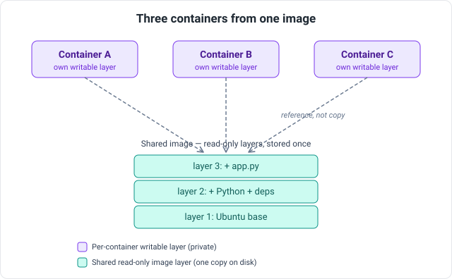

# Packaging: Docker and the Registry

Packaging is the seam between CI and CD. CI has proved a change builds and passes its tests; packaging turns that result into a single, portable unit that will run identically on a developer's laptop, a CI runner, and a production server. The unit that achieves this for most modern services is a **container image**, and Docker is the dominant tool for producing and running it.

## What a container is

A **container** is an isolated process — or group of processes — running on a host, packaged with everything it needs: its code, runtime, libraries, and system dependencies. The isolation is provided by the host operating system's own features (Linux namespaces and cgroups), so a container is not a virtual machine. A **virtual machine** emulates a whole computer and runs its own complete guest operating system on top of a hypervisor; a container shares the host's **kernel** (the core of the operating system) and isolates only at the process level. That difference is why containers start in milliseconds and are measured in megabytes, while VMs start in seconds and are measured in gigabytes.

A container carries no kernel of its own — only the code, libraries, and files above it — and its executables are compiled against one specific kernel's **system-call interface** (the API a program uses to ask the kernel for memory, files, and the like). A container is therefore built for a particular kernel, not a general one: a Linux container issues Linux system calls and runs only on a Linux kernel. This is why, on macOS or Windows, Docker quietly runs a lightweight Linux virtual machine and starts such containers inside it — the host must supply the kernel the container was built for, so "containers don't use VMs" holds only on a Linux host.

## Image versus container

Two terms that are easy to conflate. An **image** is the read-only template — the packaged filesystem plus metadata about how to start the process. A **container** is a running instance of an image: the image's layers stay read-only, and the runtime adds a single **writable layer** on top where everything the running process creates or changes is recorded, leaving the image untouched. That writable layer is thin — it holds only the container's own changes, not a copy of the filesystem — and it is discarded when the container is removed, which is why data meant to outlive a container is kept in a separate **volume** (storage mounted from outside the layer stack). The relationship mirrors a class and its objects: one image can start many containers, each with its own writable layer over the same shared image. An image is what CI produces and stores; a container is what the runtime creates from it at deploy time.

## Layers and sharing

A layer is not an instruction but the actual set of filesystem changes one build step produced — real files on disk. The Dockerfile holds the *instructions*; `docker build` runs them once and captures their results as the image's read-only layers, and a container never replays those steps — it starts from the finished layers. An image is simply an ordered stack of such layers.

Each layer is identified by a hash of its contents, so two layers holding identical files are the same object to the system. This content-addressing is what makes layers shareable: a layer is stored once on the host and downloaded once over the network. When several containers run from one image they do not each receive a copy — they all reference the same read-only layers, and each adds only its own thin writable layer on top, so the disk cost of ten containers is one image plus ten small writable layers, not ten full copies. Sharing extends across images as well: two images built on the same base share that base layer, stored once and reused, which is why pulling a second image from the same family is fast.



A **union (overlay) filesystem** stacks the layers into what the container sees as a single filesystem: reads fall through to whichever lower layer holds the file, and writes land only in the top writable layer. When a process changes a file that lives in a read-only layer, that file is first copied up into the writable layer and modified there — **copy-on-write** — leaving the shared layer beneath untouched and safe for other containers to use.

## The Dockerfile and layer caching

A Dockerfile begins with a `FROM` line naming a **base image** to build on, then adds files and runs commands, each line producing one layer.

```dockerfile
FROM eclipse-temurin:21-jdk
WORKDIR /app
COPY build.gradle settings.gradle ./
RUN ./gradlew dependencies
COPY src ./src
RUN ./gradlew build
CMD ["java", "-jar", "build/libs/app.jar"]
```

The layer model dictates instruction order. On a rebuild, Docker reuses a cached layer whenever that instruction and its inputs are unchanged, and rebuilds every layer from the first change onward. Dependency descriptors are therefore copied and resolved *before* the source is copied: editing application code invalidates only the `COPY src` layer and below, leaving the expensive dependency-download layer cached. Reverse the order and every code change would re-download all dependencies.

## Multi-stage builds

A naive image includes the whole build toolchain — compiler, build system, source — none of which the running application needs, and all of which enlarge the image and widen its attack surface. A **multi-stage build** splits the Dockerfile into stages and copies only the finished artifact into a clean final image.

```dockerfile
FROM eclipse-temurin:21-jdk AS build
WORKDIR /app
COPY . .
RUN ./gradlew build

FROM eclipse-temurin:21-jre
WORKDIR /app
COPY --from=build /app/build/libs/app.jar app.jar
CMD ["java", "-jar", "app.jar"]
```

The final image carries a Java *runtime* and the compiled jar, not the JDK or the source. This is standard practice for production images.

## Naming: tags and digests

An image is referenced by a structured name: `[registry/][namespace/]repository[:tag]`. When the registry is omitted it defaults to Docker Hub, and when the tag is omitted it defaults to `latest`. So `nginx` expands to `docker.io/library/nginx:latest`, while `123456789.dkr.ecr.us-east-1.amazonaws.com/api:build-9f2c` names a private image on AWS ECR.

A **tag** is a human-assigned, movable label — `latest` means only "the default tag," not "the newest build," and any tag can be repointed to a different image at any time. A **digest** is a `sha256` hash of the image's exact content, so it is immutable: the same digest always identifies the same bytes. Because tags can move, reproducible deployments pin the image either by digest (`api@sha256:...`) or by an immutable tag such as the Git commit SHA. Relying on `latest` in a deployment is the classic way to lose track of what is actually running.

## The registry

A **registry** is a service that stores and distributes images over a standard API. CI **pushes** a built image to it; the runtime later **pulls** the image to run it. The common registries are Docker Hub (the public default), GitHub Container Registry, and cloud-native ones such as AWS **ECR**. They differ mainly in access control and integration: ECR is private by default and authenticates through AWS **IAM** rather than a static username and password, so the same identity system that governs the rest of an AWS account governs who may push and pull images.

## Where packaging sits in the pipeline

The full seam, concretely: CI checks out the code, builds the image from the Dockerfile, tags it with an immutable identifier (typically the commit SHA), and pushes it to the registry. That pushed image *is* the build artifact from [the pipeline overview](/ci-cd/overview) — the thing CD later pulls by digest or tag and hands to the runtime. Packaging is what lets CI and CD stay decoupled: CI's only output is an addressable image in a registry, and CD's only input is that same reference.

A closing precision: "Docker" is often used loosely to mean containers in general, but the image format and runtime behaviour are standardised by the **OCI** (Open Container Initiative). Images built with Docker are OCI images and run on other runtimes (containerd, CRI-O) and can be built by other tools (BuildKit, Podman, Buildah). Docker is the dominant implementation, not the only one — which matters in the next chapter, because Kubernetes runs OCI images and does not require Docker itself.
