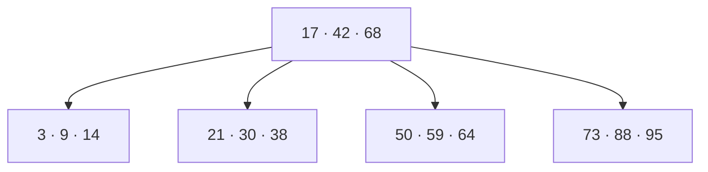

# Finding the needle

<Updated date="2026-10-11" />

<Topics tags={['Indexes', 'B-tree', 'LSM tree', 'Hash index', 'Geospatial (geohash / R-tree)', 'Inverted index', 'Composite indexes', 'Query planning']} />

Without an index, finding a row means reading every row — the database scans the whole table, start to finish, and throws away everything that doesn't match. That's fine for a hundred rows and ruinous for a hundred million.

An **index** is a separate, cleverly organised copy of one or more columns that lets the database jump almost straight to the rows it wants, instead of scanning. That speed isn't free, and the different *kinds* of lookup — ordered ranges, exact matches, locations on a map, words in a document — each want a differently shaped index. This lesson is those shapes.

## What an index costs

An index earns its keep by cutting lookup time, but you pay for it twice:

- **Disk** — the index is extra data to store alongside the table.
- **Write speed** — every time a row changes, the database must update the main table *and* every index on it. More indexes, slower writes.

So indexes shine when **reads heavily outnumber writes**. On a write-heavy table, each extra index is a tax on every write.

## B-tree — the default

The **B-tree** index is the one you'll meet almost everywhere, and it's built on a tree that stays **sorted** and **balanced**.<Sidenote>The precise rules: a B-tree is a self-balancing search tree where every leaf sits at the same depth, keys inside a node are kept in sorted order, and a node holds between m/2 and m keys (m, the "order," is the max children a node can have) — a node with k keys has k+1 children. The takeaway is just: shallow, sorted, and balanced.</Sidenote> Those two properties are the whole reason it wins:

- Because the keys stay **sorted**, range queries (`age > 25`) and `ORDER BY` are cheap — the matching rows are already next to each other, in order.
- Because it **self-balances**, performance stays predictable as the table grows, even under random inserts and deletes — no sudden "performance cliffs."
- It handles **equality** (`email = 'x'`) and **ranges** (`age > 25`) equally well.
- It keeps **disk reads** — the slow part of a lookup — to a minimum, so lookups stay fast even as the table grows enormous.<Sidenote>Reading from disk is the slow part, so what counts is *how many* disk reads a lookup needs. The index lives on disk; to search it, the database pulls nodes up into fast memory, one per level, until it reaches the row. The trick: disks read in fixed-size chunks called *pages*, and a B-tree node is exactly one page — so each read grabs a whole node, hundreds of keys, at once. Packing that many keys into each node keeps the tree very shallow, so even a table with billions of rows is only a few levels — and so only a few disk reads — deep.</Sidenote>

Each node holds many keys and points to many children, so the tree fans out fast and stays only a few levels tall — which is what keeps lookups to a handful of disk reads:



That all-round competence is why it's the default. Example: PostgreSQL's standard index.

## LSM tree — built for writes

A B-tree is great until writes dominate, because each insert means finding the right spot in the tree and writing it to disk in place — lots of small, scattered (random) writes, which disks hate. The **LSM tree** (Log-Structured Merge tree) flips this. Unlike a B-tree index, it's not a side structure — it's the storage format for the whole table, kept sorted by primary key.

The trick is in how a write happens: the data goes only to an **in-memory structure (the memtable)** and gets appended to a **log on disk** for durability — no searching for a location, no in-place update.<Sidenote>In full: the on-disk log is a write-ahead log (WAL), appended sequentially. When the memtable fills, it's flushed to disk as an immutable sorted file called an SSTable. Over time these pile up, so a background process called compaction merges them, dropping duplicates and deletions. Writes stay fast because everything is either in RAM or a sequential append.</Sidenote> Both are fast, sequential operations, so writes fly.

The cost is reads: a read may have to look in several places, so reads are slow. That makes LSM trees a fit only when **writes vastly outnumber reads**, or when slow reads are acceptable — metric collection, audit logs, IoT data streams.

## Hash index — exact matches only

A **hash index** doesn't store your rows — those still live in a main store (a B-tree's, say). It's a lookup shortcut built on a **hash table**: an array of slots, each slot called a **bucket**.

To store a value, the index runs it through a hash function and wraps the result around the number of buckets — `bucket = hash(value) % number_of_buckets` — and that gives the bucket it belongs in. Inside, the bucket keeps a short list of `value → row location` pairs. (It's a list because different values sometimes land in the same bucket.) A lookup repeats the exact same step: hash the value, jump straight to its bucket, and scan that bucket's handful of entries for the match — never the whole table. That direct jump is what makes exact lookups **O(1)**.

The catch is baked into how it stores things: hashing deliberately **scatters** values, so two that are next to each other in order — `age = 24` and `age = 25` — land in unrelated buckets. That makes a hash index **useless for ranges or sorting**; it can only answer *exact* lookups. And since a B-tree answers exact lookups nearly as fast *and* handles ranges and sorting, hash indexes are rarely used in practice — not worth raising in an interview. Example: Redis.

## Geospatial indexes — for locations

Locations break the B-tree. Ask for "restaurants within 5 miles," and a B-tree can only do it in one dimension at a time: find everything in the latitude band `(x−5, x+5)`, find everything in the longitude band `(y−5, y+5)`, and intersect them. That gives you a 10-mile *square*, not a circle, so you still have to filter out the corners — and those band scans are expensive. The root problem: a B-tree is a 1-D sorted list, and a location is 2-D. The three fixes below all do the same basic thing — turn 2-D space into something a database can index — in different ways.

### Geohash

Geohash is the most common of the three, and the clearest to picture. It chops the whole world into a grid of cells and gives each cell a short **Base32 code** (a mix of letters and digits). The cells are **nested**, and the codes are built to match: a cell that sits inside a larger one keeps the larger cell's entire code and adds one more character. So each character you tack on names a smaller cell within the last — and a longer code is a smaller, more precise cell:

```
9q8y   → roughly San Francisco
9q8yy  → a neighborhood inside it
9q8yyk → a single block
```

<figure className="diagram">
<svg viewBox="0 0 300 300" width="300" height="300" role="img" aria-label="Three nested geohash cells. Each extra character names a smaller box inside the previous one. Two nearby points sit in the same innermost box, so their codes share that box's code as a prefix.">
  <rect className="d-fill" x="20" y="20" width="260" height="260" rx="4" />
  <rect className="d-stroke" x="20" y="20" width="260" height="260" rx="4" strokeWidth="1.5" />
  <text className="d-label" x="28" y="42" fontSize="15">9q8y</text>
  <rect className="d-fill" x="90" y="90" width="150" height="150" rx="3" />
  <rect className="d-stroke" x="90" y="90" width="150" height="150" rx="3" strokeWidth="1.5" />
  <text className="d-label" x="98" y="110" fontSize="13">9q8yy</text>
  <rect className="d-fill" x="140" y="140" width="80" height="80" rx="2" />
  <rect className="d-stroke" x="140" y="140" width="80" height="80" rx="2" strokeWidth="1.5" />
  <text className="d-label" x="147" y="158" fontSize="11">9q8yyk</text>
  <circle className="d-accent" cx="168" cy="192" r="4" />
  <circle className="d-accent" cx="192" cy="202" r="4" />
</svg>
<figcaption>A cell nested inside another keeps its parent's code and adds one character, so a longer code names a smaller cell. The two points fall in the same innermost cell — so their codes share that cell's code as a prefix.</figcaption>
</figure>

Now the payoff. Because a cell's code is the prefix of every cell nested inside it, two points that are physically close — close enough to land in the same small cell — get codes that **start with the same characters**. So "find places near here" quietly becomes "find codes that start with this prefix," and an ordinary B-tree, which keeps strings sorted, answers a prefix search instantly. The 2-D location has turned into a plain string a normal database can index. (A radius search that spills over a cell's edge just checks the neighboring cells too — which is how Redis `GEOSEARCH` works.)

Geohash has two weaknesses, and both come from its grid being fixed:

- **Edge-of-grid problem** — two points can sit just metres apart yet fall on opposite sides of a grid line, which gives them codes with *different* prefixes, so a prefix search finds one and misses the other. (The fix is the neighbor-check from above: always look at the adjacent cells too.)
- **Uniform cells** — the grid carves the planet into equal squares, so a cell over empty ocean gets exactly as much detail as a cell over a packed city centre — wasted precision where there's nothing, and sometimes too little where everything is.

### Quadtree

A quadtree removes that waste by shaping itself to the data. It starts with the whole map as one cell and splits a cell into four quadrants *only* when it gets too crowded (say, more than five points fall inside it). Busy places like city centres keep subdividing into tiny cells, while empty places like deserts stay as a few big ones — so memory is spent only where there's actually data.

<figure className="diagram">
<svg viewBox="0 0 300 300" width="300" height="300" role="img" aria-label="A quadtree. The crowded top-right quadrant is split into small cells, while the sparse quadrants stay large, so detail follows where the points are.">
  <rect className="d-fill" x="20" y="20" width="260" height="260" rx="4" />
  <rect className="d-stroke" x="20" y="20" width="260" height="260" rx="4" strokeWidth="1.5" />
  <line className="d-stroke" x1="150" y1="20" x2="150" y2="280" strokeWidth="1" />
  <line className="d-stroke" x1="20" y1="150" x2="280" y2="150" strokeWidth="1" />
  <line className="d-stroke" x1="215" y1="20" x2="215" y2="150" strokeWidth="1" />
  <line className="d-stroke" x1="150" y1="85" x2="280" y2="85" strokeWidth="1" />
  <line className="d-stroke" x1="247" y1="20" x2="247" y2="85" strokeWidth="1" />
  <line className="d-stroke" x1="215" y1="52" x2="280" y2="52" strokeWidth="1" />
  <circle className="d-accent" cx="230" cy="36" r="3.5" />
  <circle className="d-accent" cx="262" cy="40" r="3.5" />
  <circle className="d-accent" cx="228" cy="68" r="3.5" />
  <circle className="d-accent" cx="258" cy="70" r="3.5" />
  <circle className="d-accent" cx="238" cy="44" r="3.5" />
  <circle className="d-accent" cx="75" cy="210" r="3.5" />
  <circle className="d-accent" cx="90" cy="80" r="3.5" />
  <circle className="d-accent" cx="215" cy="215" r="3.5" />
</svg>
<figcaption>A quadtree splits a cell into four only where points pile up. The crowded top-right keeps subdividing into small cells; the empty areas stay large — so detail follows the data.</figcaption>
</figure>

The price is that it's more complex than geohash's plain strings:

- **Custom structure** — geohash hands you ordinary strings any database can index with a normal B-tree, but a quadtree is its own kind of tree the database has to build and maintain specially.
- **Usually in-memory** — it doesn't map neatly onto disk pages, so it's typically held entirely in memory.
- **Can go lopsided** — if nearly all your points cluster in one small area, that single branch keeps splitting and the tree turns deep and unbalanced.

### R-tree

The R-tree is the one most real databases actually use — it's the default spatial index in PostGIS and MySQL. Rather than grid cells, it draws **rectangles around groups of nearby objects**, and those rectangles can be different sizes and can overlap, so they hug wherever the data really sits — more flexible and accurate than geohash's rigid grid. A search then walks down only the rectangles that overlap the area you're asking about.

<figure className="diagram">
<svg viewBox="0 0 300 260" width="300" height="260" role="img" aria-label="An R-tree. Nearby points are wrapped in bounding rectangles of different sizes; two of the rectangles overlap.">
  <rect className="d-stroke" x="45" y="45" width="75" height="65" rx="3" strokeWidth="1.5" />
  <rect className="d-stroke" x="150" y="80" width="80" height="75" rx="3" strokeWidth="1.5" />
  <rect className="d-stroke" x="130" y="135" width="95" height="65" rx="3" strokeWidth="1.5" />
  <circle className="d-accent" cx="60" cy="67" r="3.5" />
  <circle className="d-accent" cx="90" cy="59" r="3.5" />
  <circle className="d-accent" cx="72" cy="93" r="3.5" />
  <circle className="d-accent" cx="104" cy="87" r="3.5" />
  <circle className="d-accent" cx="172" cy="100" r="3.5" />
  <circle className="d-accent" cx="205" cy="95" r="3.5" />
  <circle className="d-accent" cx="188" cy="130" r="3.5" />
  <circle className="d-accent" cx="215" cy="125" r="3.5" />
  <circle className="d-accent" cx="150" cy="180" r="3.5" />
  <circle className="d-accent" cx="180" cy="190" r="3.5" />
  <circle className="d-accent" cx="210" cy="183" r="3.5" />
  <circle className="d-accent" cx="160" cy="163" r="3.5" />
</svg>
<figcaption>An R-tree wraps nearby objects in rectangles that fit the data — different sizes, and allowed to overlap. A search only opens the rectangles that touch the area you asked about.</figcaption>
</figure>

Two things set it apart:

- **It can index shapes, not just points** — geohash and quadtree only ever pin down a *point*: a single lat/long, like a restaurant's location. But a river or a country border isn't a point — it's a line or an area, something with size. An R-tree copes because its unit is a *rectangle*, not a point: you wrap each object in the smallest box that contains it, and a box can enclose a whole river or border just as easily as one dot. That makes R-trees the natural choice for indexing real shapes — polygons and lines like country borders, rivers, and delivery zones.
- **Writes are expensive** — adding or moving an object can force the surrounding rectangles to be recomputed and split, which is genuine geometric work. So an R-tree is a poor fit for data that changes every moment, like thousands of drivers' GPS positions updating each second.

## Inverted index — for text search

A B-tree can match a prefix (`LIKE 'database%'`) but not a substring (`LIKE '%database%'`) — that forces the database to bypass the index and scan every character of every row. An **inverted index** is built for searching *inside* text. It flips the natural relationship: instead of storing documents → their words, it stores **words → the list of documents containing them** (a "postings list"):

```
Doc 1: "B-trees are fast"
Doc 2: "Hash tables are fast"

b-trees → [Doc 1]
tables  → [Doc 2]
fast    → [Doc 1, Doc 2]
```

Real engines (Elasticsearch, Apache Lucene) first run text through an **analysis pipeline** — tokenization (split into words), normalization (lowercase), stop-word removal (drop "the", "and"), and stemming ("running", "runs" → "run"). On top of that they add the features that make real search feel smart:

- **Relevance scoring** — a search can match thousands of documents, so the engine ranks them and shows the best first.<Sidenote>Two standard scoring formulas, **TF-IDF** and **BM25**, built on the same intuition: a document that uses your search word often is probably more about it (*term frequency*), and a word that's rare across the whole collection is more distinctive than a common one, so matching it counts for more (*inverse document frequency*). BM25 is the refined modern default.</Sidenote>
- **Fuzzy matching** — finds a word even when you mistype it, so "databse" still matches "database." (It measures how many single-character edits separate the two.)
- **Phrase queries** — match words in a specific order and right next to each other, so `"machine learning"` finds only documents where those two words sit together — not ones that say "machine" in one place and "learning" in another.

The trade-offs: **high storage** (a huge dictionary of words), and **expensive writes** — changing one document means updating the postings list of every word in it. Use cases: log analysis (the ELK stack), GitHub code search, Slack message history.

## Picking an index

| Need | Index |
| --- | --- |
| General-purpose querying (equality + ranges + sorting) | **B-tree** |
| Exact matches only | **Hash** |
| Locations | **Geospatial** (geohash / quadtree / R-tree) |
| Text search | **Inverted** |

## Queries that touch several columns

Real queries rarely filter on just one column. Take this one:

```sql
WHERE user_id = 123 AND created_at > '2024-01-01' ORDER BY created_at
```

Two filters and a sort. You have two ways to make it fast: build one index for both columns, or keep a separate index per column and let the database stitch them together.

**One index for both — a composite index.** A composite index covers several columns at once, like `index(user_id, created_at)`. It's still a B-tree, but each key is the two values joined into one, kept sorted by `user_id` first and then by `created_at` within each `user_id`. For a multi-column filter that beats separate indexes outright: separate indexes each have to be scanned and their results combined, while a well-matched composite index answers the whole query in a **single scan**.

The catch is **order** — and it's the order of the columns *in the index*, not the order you happen to write the conditions in your query.<Sidenote>The second is a common worry but a non-issue: `WHERE user_id = 123 AND created_at > …` and `WHERE created_at > … AND user_id = 123` are identical to the database. `AND` is commutative, and the optimizer reorders the conditions by cost regardless of how you type them — so the column order baked into the index is the part you actually control.</Sidenote> `index(user_id, created_at)` is *not* the same as `index(created_at, user_id)`: because the B-tree sorts by the first column first, your query has to line up with the index's leading column(s). An index led by `user_id` is no help at all to a query that only filters on `created_at`.

**Separate indexes — and the optimizer's three moves.** If instead you keep a separate index on each column, the database doesn't guess how to combine them. Its **query optimizer** estimates the cost of each plan and picks the cheapest, leaning mostly on **cardinality** — how selective each filter is. It lands on one of three:

- **Single index + filter** (the usual winner) — use the most selective index to grab a small set of rows, then filter and sort the rest in memory. If `user_id = 123` matches only 50 rows out of millions, it uses the `user_id` index and throws away the stragglers. If `created_at` is the selective one instead, it uses that — and gets the sort *for free*, since that index already comes out ordered by `created_at`.
- **Index merge** — when neither filter is selective on its own, some engines scan *both* indexes for row IDs, intersect the two lists (an AND), then fetch only the rows in both and sort them. Stitching the lists together costs something, so the optimizer reaches for this only when no single index is selective enough.
- **Full table scan** (the worst case) — if the table is tiny, or the filters match most of it anyway (say `user_id = 123` covers 90% of the rows and nearly all are recent), the indexes aren't worth loading. The database just reads the whole table, filters, and sorts.
