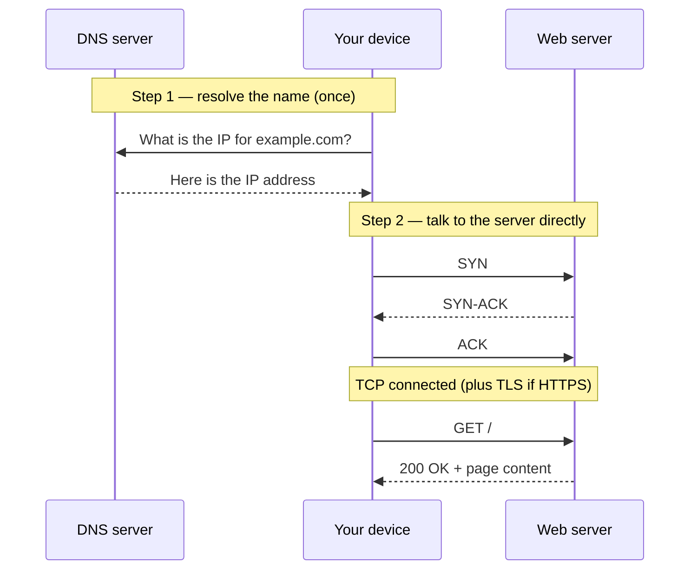

# What happens when you open a web page

<Topics tags={['DNS', 'TCP handshake', 'OSI layers', 'TCP / UDP / QUIC', 'HTTP methods', 'Status codes', 'NAT']} />

You type an address, press enter, and a page appears a fraction of a second later. In that fraction of a second a request leaves your device, crosses your home, your city, and possibly an ocean, finds one specific machine out of the billions on the internet, and comes back with an answer. Almost everyone who builds software relies on this happening and can't actually trace it end to end.

This lesson traces it. First the round trip itself, then the layers underneath that make it work, and finally the rules of the protocol that rides on top — because every later topic in system design is, in some sense, a variation on making this round trip faster, more reliable, or able to happen a million times at once.

## The round trip

Say you open `www.example.com` from your laptop on home Wi-Fi.

Your device doesn't yet know *where* `example.com` is — it has a name, not an address. So the first thing it does is ask a **DNS server** to translate the human-readable name into an IP address.<Sidenote>DNS is the internet's phone book: it maps names people can remember to the numeric addresses machines actually route to.</Sidenote> It's **your device** that makes this request, not the router — the router only passes it along. That question travels from your device to your router, out through your ISP, across the internet to a DNS server, and the IP address comes back the same way.

Now your device has an address it can route to. But before any real data moves, it opens a reliable connection to the server with a **TCP three-way handshake**:<Sidenote>TCP (Transmission Control Protocol) is the protocol that opens a reliable, in-order connection between two machines — it re-sends lost packets and hands the bytes over in the order they were sent. The handshake below is how that connection gets set up. The transport-layer section covers it in full.</Sidenote>

- **SYN** — your device to the server: "I'd like to talk."
- **SYN-ACK** — the server back to you: "Go ahead, I'm listening."
- **ACK** — your device again: "Great, starting now."

Only after that handshake completes — plus a **TLS handshake** if the site is HTTPS<Sidenote>TLS (Transport Layer Security) is the step that encrypts the connection, so no one between you and the server can read it. It runs after TCP connects and before the first real request — the "S" in HTTPS — which is why HTTPS pages cost a little more to set up.</Sidenote> — does the actual HTTP request reach the server. The server processes it, sends the response back along the same path, and your browser renders the page.

Two things are worth being precise about, because they are where intuition usually goes wrong.

1. **Routers don't "find" the server.** It's tempting to picture your router or your ISP looking up where the server is and fetching the page. They don't. They only **forward packets hop by hop** — across fiber, undersea cables, exchange points — each hop passing the packet a little closer to the machine holding that IP. No single router knows the whole path; each just knows the next step. The handshake itself is between your device and the server; the routers in between are not participants in it, only carriers.

2. **Different links do different jobs.** Wi-Fi (radio) carries the hop between your device and your router. Physical cables carry everything from the router out to the server. And TCP, running the whole length, is what makes that unreliable chain of hops behave like a reliable connection between your device and the server.

## The layers underneath

That round trip touched three different concerns — finding the machine, holding a reliable connection, and speaking a shared language — and each is handled by a different **layer**. These are three of the seven layers in the **OSI model** (Open Systems Interconnection).<Sidenote>The OSI model has seven layers in total. The other four matter less for system-design interviews; the network, transport, and application layers are where almost all the decisions you'll reason about live.</Sidenote> They're worth separating because the rest of system design keeps returning to them.

### Network layer — addressing and routing

The network layer is responsible for **routing and addressing**: getting a packet to the right machine across the internet. Every device is identified by an **IP address**, and that address is how the internet knows where to send things.

There's a detail here that's easy to state wrong. Your router does assign addresses — but the address it hands your laptop is a **private** IP, valid only inside your home network.<Sidenote>The router hands out private addresses with DHCP. Addresses like `192.168.x.x` are private and not routable on the public internet.</Sidenote> The **public** IP — the one the rest of the internet sees — belongs to your router and is assigned by your ISP. The router performs **NAT** (Network Address Translation) to map the many private addresses behind it onto that one public address, so every device in your house can share a single public IP.

### Transport layer — the actual connection

Where the network layer gets a packet to the right machine, the transport layer governs the **connection** between the two machines once they can reach each other. Three protocols matter: **TCP**, **UDP**, and **QUIC** — the last of which is comparatively new.<Sidenote>QUIC runs on top of UDP and is the transport underneath HTTP/3. It aims to give TCP-like reliability with less connection-setup delay.</Sidenote>

**UDP** (User Datagram Protocol) is the bare minimum:

- **Connectionless** — no handshake, no setup.
- **No delivery guarantee** — packets can be lost with no notification.
- **No ordering** — packets may arrive in a different order than they were sent.
- **Low latency** — less overhead means faster transmission.

That trade is exactly right for something like live streaming, where an occasional dropped packet is invisible but waiting to re-send it would not be.

**TCP** (Transmission Control Protocol) is the opposite trade. It provides **reliable, ordered, error-checked** delivery: it establishes a dedicated connection first — the three-way handshake you just saw — and maintains it for the whole session. It's **connection-oriented**, and it guarantees your data arrives in order and intact. That reliability is why the web runs on it, and it's why TCP is doing the quiet work behind the round trip above.

### Application layer — HTTP

The application layer defines how applications actually talk **over** the transport layer. For the web, that protocol is **HTTP** (and **HTTPS**, its encrypted form): the rules for how a client and server exchange a request and a response.

HTTP specifies three things:

- what a **request** looks like (its method, headers, and so on),
- what a **response** looks like (a status code, headers, a body),
- and the **pattern** itself: one request, one response.

Crucially, HTTP is **stateless** — every request is independent, and the server is not required to remember anything about your previous requests. That one property shapes an enormous amount of system design: because the protocol carries no memory, anything that needs to persist between requests (who you are, what's in your cart) has to be arranged deliberately, somewhere else.

**Request methods** express intent:

| Method | Meaning |
| --- | --- |
| `GET` | Read a resource from the server |
| `POST` | Create a new resource |
| `PUT` | Update (replace) a resource |
| `PATCH` | Partially update a resource |
| `DELETE` | Remove a resource |

**Status codes** summarise the outcome in one number, grouped by their first digit:

- **2xx** — success.
- **3xx** — moved / redirected.
- **4xx** — client error (the request was wrong).
- **5xx** — server error (the request was fine; the server failed).

---

That's the whole journey: a name resolved to an address, a reliable connection built over an unreliable chain of hops, and a stateless request-and-response spoken on top of it. Keep the three layers in mind — addressing, connection, protocol — because the next questions in system design are really just this round trip under strain: what happens when one server isn't enough, when the data is too far away, or when the request has to survive a failure halfway through.
